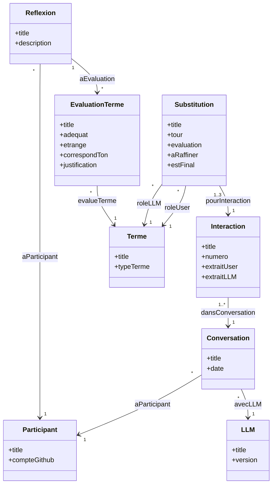

# Diagramme de classes — Ex5 Subtracting the Machine

Chaque classe correspond à une classe du vocabulaire `artinq` (fichier `artificial_inquiries.ttl`) et à un modèle de ressource Omeka S (dossier `resource-template/`).

Préfixes : `title`, `date` et `description` viennent de **Dublin Core** (`dcterms:`) ; toutes les autres propriétés et les liens viennent du vocabulaire **artinq** (`artinq:`).

## Explication

| Classe | Rôle dans l'exercice |
|---|---|
| **Participant** | La personne qui fait l'exercice. |
| **LLM** | Le modèle utilisé (ChatGPT, Claude…). |
| **Conversation** | Une conversation passée avec un LLM (4 par participant). |
| **Interaction** | Un échange précis : bulles « User » et « LLM » (Ex5a). |
| **Substitution** | Un tour de soustraction (1 à 3) : un terme pour l'utilisateur, un terme pour le LLM. |
| **Terme** | Un mot de remplacement (« un traiteur », « Wikipedia »…) ; les termes finaux forment le lexique. |
| **EvaluationTerme** | Les 3 questions de l'Ex5b sur un terme final : adéquat ? étrange ? correspond au ton ? |
| **Reflexion** | Le texte de réflexion de l'Ex5b. |

Les liens entre classes sont des propriétés `artinq` de type « Item » dans Omeka S : on les crée de l'enfant vers le parent (une Interaction pointe vers sa Conversation, etc.).

## Comment ces classes ont été choisies (utilisation de l'IA)

Les classes et les propriétés de ce diagramme ont été définies avec l'aide d'une IA générative : **Claude** (Anthropic), modèle **Claude Opus 5.5**.

**Démarche :**
1. J'ai donné à l'IA le texte de l'exercice 5 (vademecum *Artificial Inquiries*, p. 31-36) et la consigne du cours.
2. L'IA a proposé une classe pour chaque élément de l'exercice :
   - les **4 conversations** à choisir → `Conversation` ;
   - le **message + la réponse** recopiés dans les bulles « User » et « LLM » → `Interaction` ;
   - les **tours de soustraction** (jusqu'à 3) → `Substitution` ;
   - les **mots de remplacement** (« un traiteur », « Wikipedia »…) → `Terme` ;
   - les **3 questions de l'Ex5b** (adéquat ? étrange ? correspond au ton ?) → `EvaluationTerme` ;
   - le **texte de réflexion** de l'Ex5b → `Reflexion` ;
   - la personne qui fait l'exercice et le LLM utilisé → `Participant` et `LLM`.
3. J'ai vérifié que chaque classe correspond bien à une étape ou à une donnée de l'exercice.
4. J'ai testé le modèle dans mon Omeka S local en créant les items de l'exemple du vademecum (« Birthday celebration dish ideas »).

**Pourquoi ces classes sont utiles :** elles permettent d'enregistrer toutes les données de l'exercice et de les relier entre elles. On peut ainsi retrouver pour chaque interaction l'historique des tours, construire le lexique final et comparer les termes choisis par plusieurs participants.
