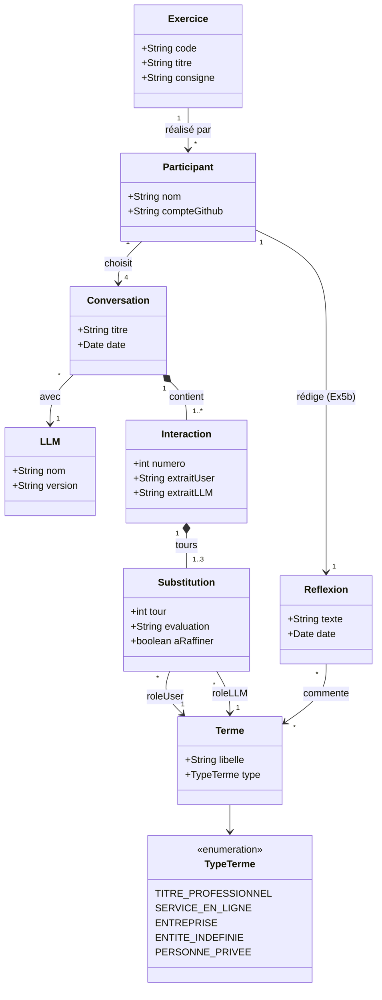

# Diagramme de classes — Ex5 Subtracting the Machine

## Explication

- **Participant** : la personne qui fait l'exercice. Elle choisit **4 conversations**.
- **Conversation** : une conversation passée avec un **LLM**, identifiée par son titre.
- **Interaction** : un échange précis (message + réponse), recopié dans les bulles « User » et « LLM ».
- **Substitution** : un tour de soustraction (1 à 3), qui associe un **terme** au rôle de l'utilisateur et un autre au rôle de la machine.
- **Terme** : un mot de remplacement (« un traiteur », « Wikipedia », « un fantôme »), stocké une seule fois pour construire le **lexique**.
- **Reflexion** : le texte de l'Ex5b sur les termes finaux.
